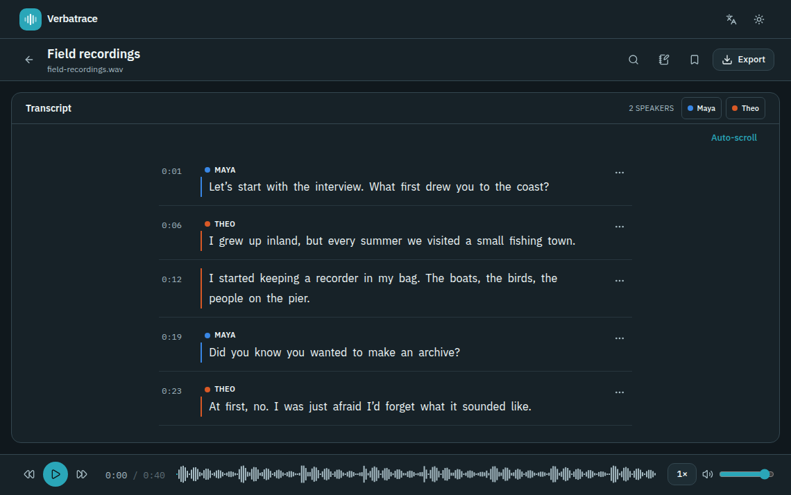

# 

English | [Русский](README.ru.md)

[](https://github.com/iaminsleep/verbatrace/actions/workflows/ci.yml?query=branch%3Amain)

Privately transcribe audio and video in your browser.

[Run locally](#run-locally) · [Documentation](#documentation)



## Try the demo

The [live demo](https://verbatrace.pages.dev/) runs the full app in your browser.

## Run locally

Use Node.js 22 or newer and a desktop Chromium browser.

```bash
npm ci
npm run setup
npm start
```

Open [localhost:5173](http://localhost:5173). Setup downloads the Parakeet TDT 0.6B v3 model (670 MB). For speaker identification, run `npm run diarization-model` and reload.

For Docker, run `docker compose up -d` and open [127.0.0.1:3000](http://127.0.0.1:3000).

## Documentation

- [Self-hosting and troubleshooting](docs/self-hosting.md)
- [Development and tests](CONTRIBUTING.md)
- [Reporting a security issue](SECURITY.md)
- [Third-party models, fonts and licenses](THIRD_PARTY_NOTICES.md)

[MIT license](LICENSE)

## Feedback

Feedback, bug reports, and feature suggestions are welcome.

If you find Verbatrace useful or have ideas for improving it, feel free to open an issue or start a discussion.

For questions or other inquiries: **iaminsleep@gmail.com**
