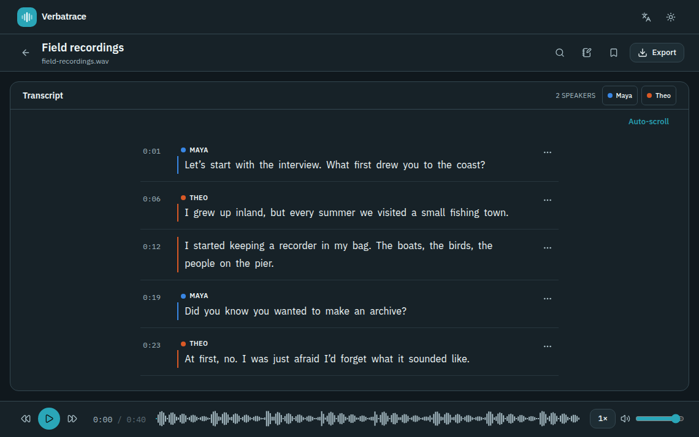

# 

[English](README.md) | Русский

[](https://github.com/iaminsleep/verbatrace/actions/workflows/ci.yml?query=branch%3Amain)

Приватно расшифровывайте аудио и видео прямо в браузере.

[Локальный запуск](#локальный-запуск) · [Документация](#документация)



## Попробовать демо

В [демо](https://verbatrace.pages.dev/) доступна полная рабочая версия приложения.

## Локальный запуск

Нужны Node.js 22 или новее и настольный браузер на базе Chromium.

```bash
npm ci
npm run setup
npm start
```

Откройте [localhost:5173](http://localhost:5173). При установке скачается модель Parakeet TDT 0.6B v3 (670 МБ). Для определения спикеров выполните `npm run diarization-model` и обновите страницу.

Для Docker выполните `docker compose up -d` и откройте [127.0.0.1:3000](http://127.0.0.1:3000).

## Документация

- [Развёртывание и устранение неполадок](docs/self-hosting.md)
- [Разработка и тесты](CONTRIBUTING.md)
- [Как сообщить об уязвимости](SECURITY.md)
- [Сторонние модели, шрифты и лицензии](THIRD_PARTY_NOTICES.md)

[Лицензия MIT](LICENSE)

## Обратная связь

Буду рад отзывам, сообщениям об ошибках и предложениям по новым функциям.

Если проект Verbatrace оказался вам полезен или у вас есть идеи по его улучшению, создайте Issue или начните обсуждение в репозитории.

По вопросам и другим обращениям можно написать мне на электронную почту: **iaminsleep@gmail.com**
